# TP Programmation Mobile — L3 GTIC (ISET'COM, 2026/2027)

Travaux pratiques **TP3** (Android / Kotlin) et **TP4** (Flutter).

```
TP3/
  MesCoursApp/        Exercice guidé : Login "Remember Me" + cours.json + SQLite (table notes)
  MiniShopManager/    Travail à faire : Login "Remember Me" + produits.json + SQLite (table panier)
TP4/
  hello_world/        Premier projet Flutter "Hello World"
  compteur/           Exercice : application compteur (StatefulWidget + setState)
captures/
  TP3/  TP4/          Captures d'écran des exécutions (émulateur Android)
```

---

## TP3 — Catalogue dynamique (Android Studio, Kotlin)

### Notions mises en œuvre
| Notion | Où |
|---|---|
| `SharedPreferences` (pattern « Se souvenir de moi ») | `LoginActivity.kt` |
| Lecture d'un JSON local dans `assets/` (`JSONObject`) | `ListeCoursActivity.kt`, `CatalogueActivity.kt` |
| `ListView` + `ArrayAdapter` | listes des cours / produits / panier |
| SQLite (`SQLiteOpenHelper`, `ContentValues`, `insert`, `rawQuery`) | `DBHelper.kt` |

### MesCoursApp (exercice)
1. Saisie du nom + case « Se souvenir de moi » → Connexion.
2. Liste des cours chargée depuis `assets/cours.json`.
3. Clic sur un cours → Toast + insertion dans la table `notes` (`cours.db`) avec une note aléatoire.
4. Relance de l'application → le nom est prérempli.

| Login | Login rempli | Liste (JSON) | Toast + SQLite | Relance (Remember Me) |
|---|---|---|---|---|
| 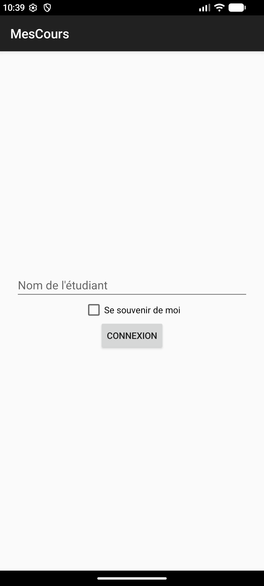 | 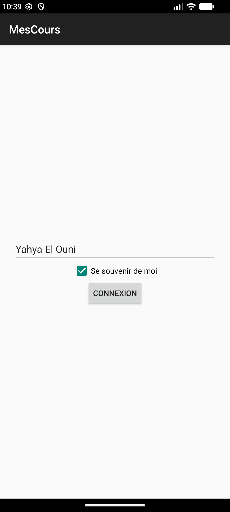 | 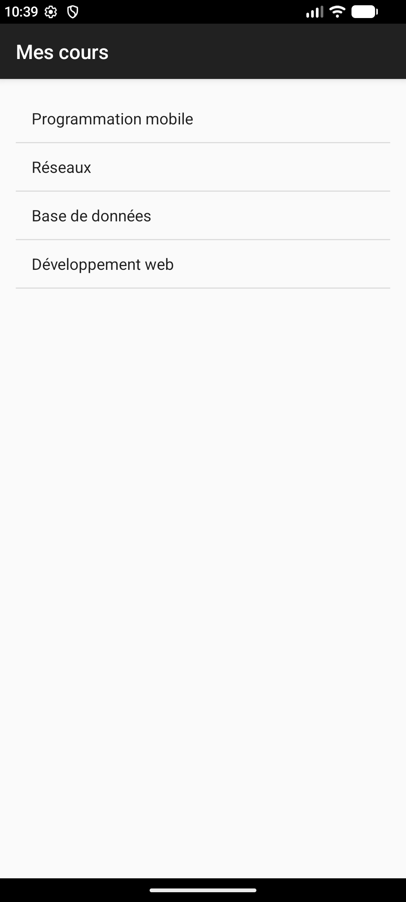 | 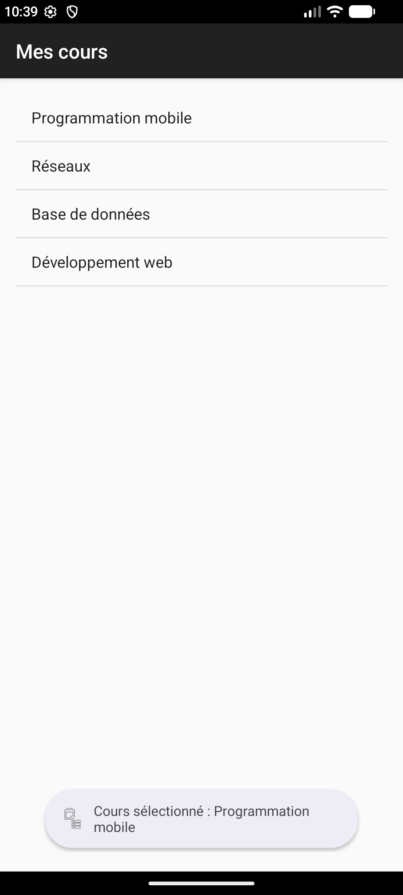 |  |

Contenu de la table `notes` :

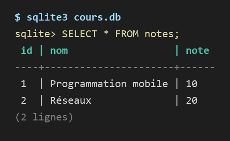

### MiniShop Manager (travail à faire)
- **Login** : nom d'utilisateur + mot de passe, « Se souvenir de moi » via `SharedPreferences` (`MiniShopPrefs`). À la reconnexion, le champ utilisateur est prérempli.
- **Catalogue** : `assets/produits.json` (8 produits : nom, catégorie, prix) affichés dans une `ListView`.
- **SQLite** : base `minishop.db`, table `panier(id, produit_id, nom, prix, date_ajout)`. Chaque clic sur un produit → Toast « … ajouté au panier » + une ligne insérée.
- Bonus : écran **Mon panier** (lecture de la table, total, vider le panier) et bouton Déconnexion.

| Login | Remember Me | Catalogue (JSON) | Toast d'ajout | Panier (SQLite) | Relance : prérempli |
|---|---|---|---|---|---|
| 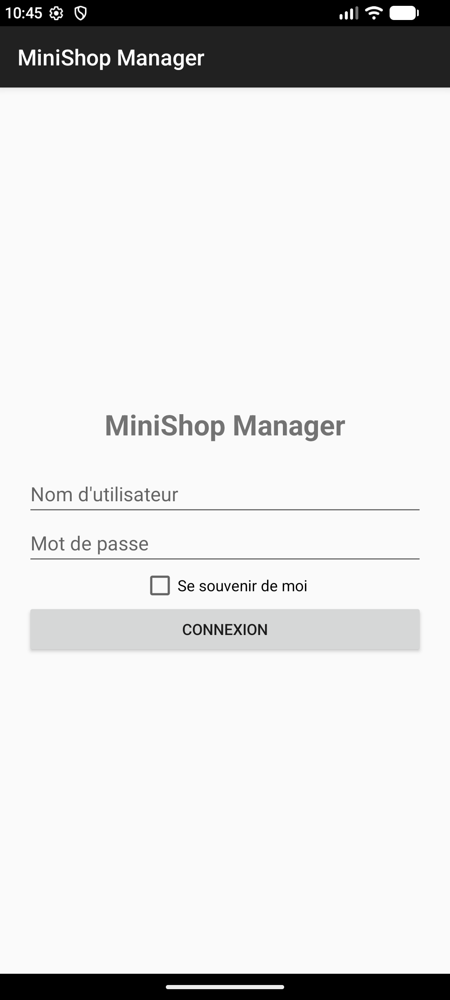 | 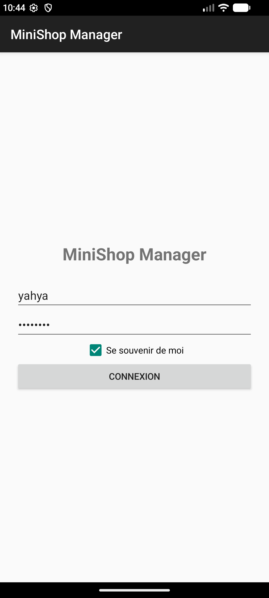 | 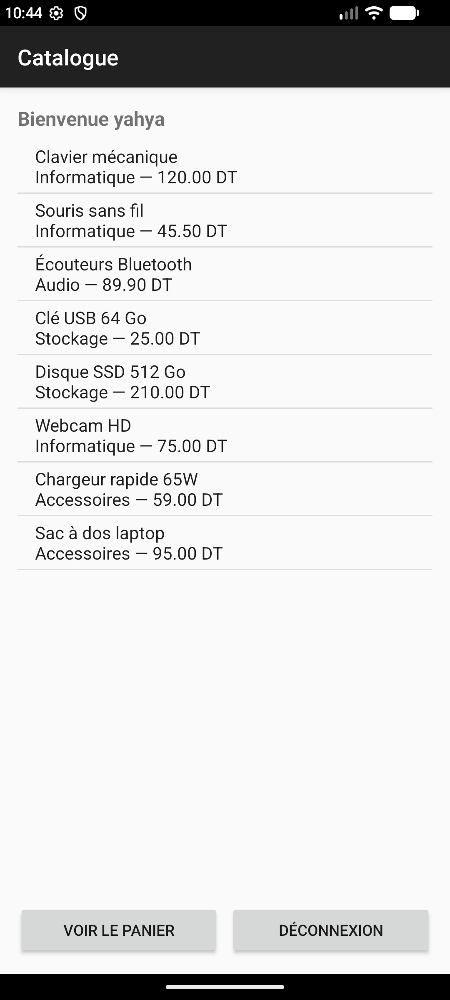 | 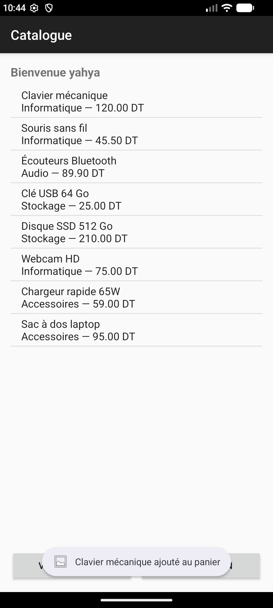 | 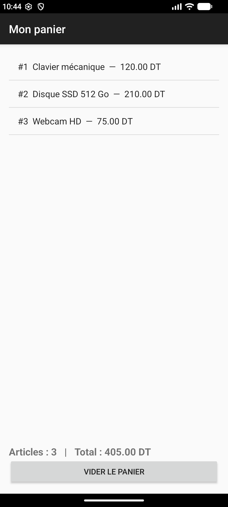 | 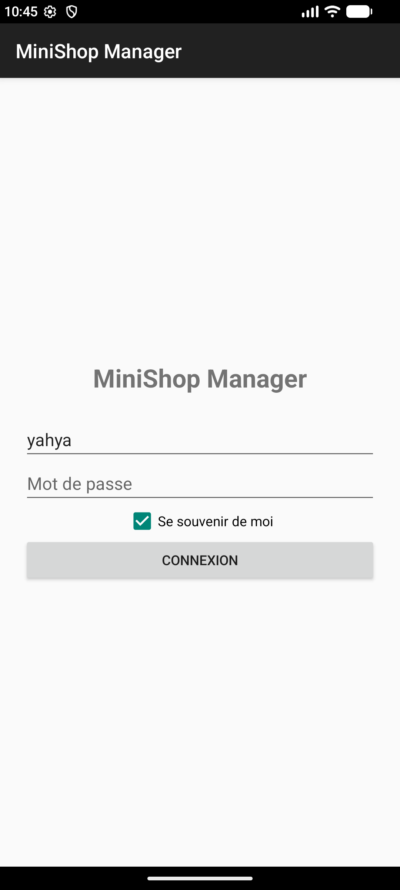 |

Contenu de la table `panier` :

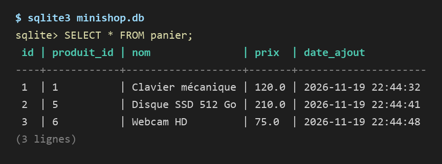

### Exécution
Ouvrir `TP3/MesCoursApp` ou `TP3/MiniShopManager` dans Android Studio puis **Run**, ou en ligne de commande :
```
./gradlew installDebug
```

---

## TP4 — Flutter

### Installation
SDK Flutter installé et ajouté au `PATH`, plugins Flutter/Dart dans Android Studio et VS Code, validation avec `flutter doctor` (voir capture).

### Hello World
`flutter create hello_world` puis remplacement de `lib/main.dart` (`MaterialApp` → `Scaffold` + `AppBar` + texte centré).

### Exercice : compteur
`lib/main.dart` de `compteur/` : `HomePage` est un `StatefulWidget` ; le `FloatingActionButton` appelle `setState()` pour incrémenter `_counter`, ce qui reconstruit l'interface.

| flutter doctor | Hello World | Compteur = 0 | Compteur = 3 |
|---|---|---|---|
| 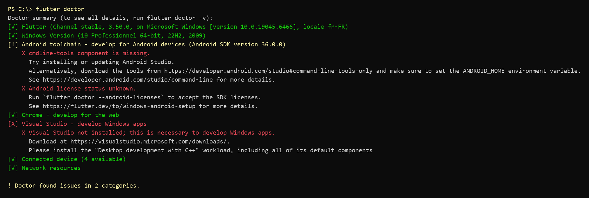 |  |  | 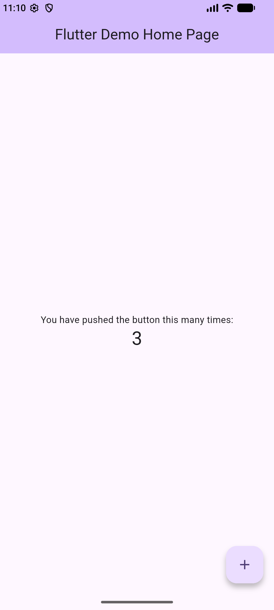 |

### Exécution
```
cd TP4/compteur
flutter pub get
flutter run
flutter test
```
